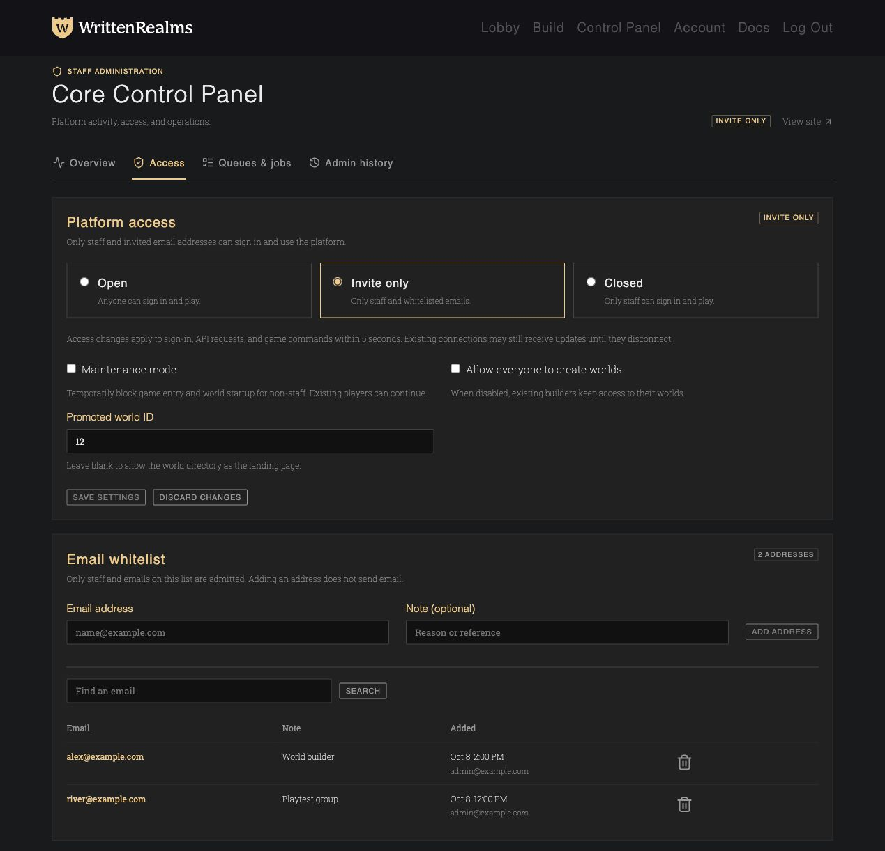

# Control Panel development

Open `/staff` (or `/staff/panel`) with a staff account. Operator instructions are in [the administration guide](../guides/administrators/control-panel.md).

```sh
make test
docker compose exec frontend npm test
docker compose exec frontend npm run build
make docs-build
```

The API lives in `backend/system/control_{overview,access,jobs}.py`; admission is shared through `backend/system/access.py`. Migration `system.0027_platform_control_access` adds the access mode, email whitelist, and administrative audit records. The database is the sole admission policy; environment admission variables are ignored. The FastAPI gateway resolves current account identity and policy on a synchronous ORM thread at authentication, keeping the event loop free. A cold invited socket uses three indexed/bounded queries, and a warm decision uses none.

The overview is 10 database queries on a cache miss, independent of result size, and no analytics queries on a cache hit. Regression coverage uses 506 online characters and 56 running worlds, while returning at most 100 characters and 50 worlds. Durable queue summaries use 9 queries, including a regression with 505 failures that returns only 10 failure details. Snapshots are shared for 15 seconds. Game admission caches expire after 5 seconds and retain at most 4,096 entries per process; warm admission adds no database queries.

Queue inspections use a one-second broker socket timeout and a one-second deadline for each worker inspection phase. Separate queue and overview requests prevent a broker failure from blocking the dashboard. Broker output excludes task arguments, results, credentials, and raw exception strings. Recovery submissions are restricted to three existing bounded tasks and have a shared 30-second cooldown.

## Browser checks

With the frontend running, open `/tests/browser/controlPanel.html?test=1`. This renders the real components with synthetic data and intercepts all API requests. It checks rendering, draft preservation between tabs, failed and successful saves, unavailable queue data, audit history, and page overflow. It creates no accounts and changes no backend data. The harness is not a production application route.

The fixture uses invite-only database settings and two synthetic invitations. Both status badges and the selected mode must agree; unsaved edits and unrelated saves must preserve the saved status. The display uses the existing settings response and adds no API requests or admission-path work.

The preview passed all 19 browser checks at 1,280 × 720 and 390 × 844 on October 13, 2026.



These screenshots use synthetic data. The browser checks passed at desktop (1,280 × 960) and mobile (390 × 844) sizes:


[Mobile screenshot](screenshots/core-control-panel-mobile.jpg)
