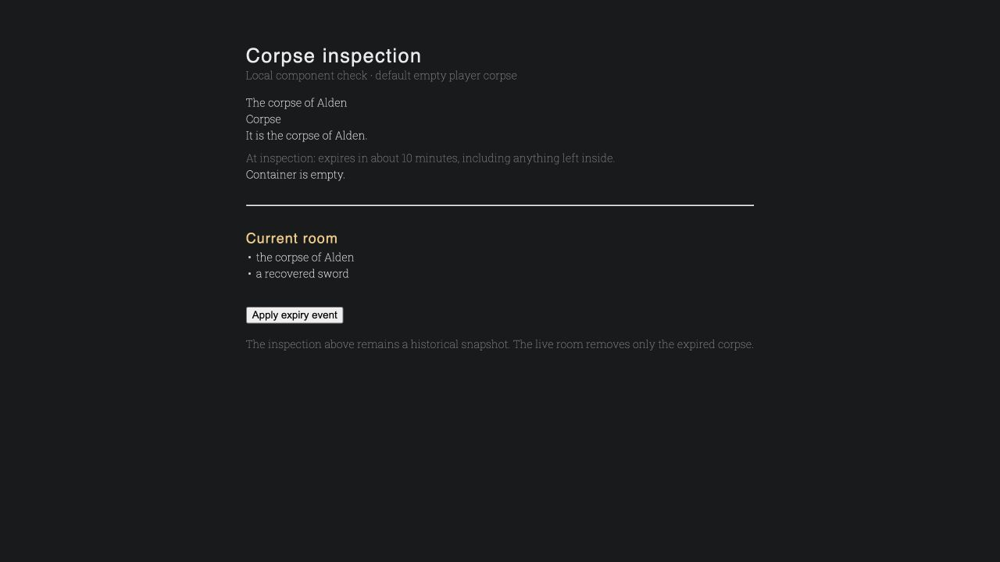
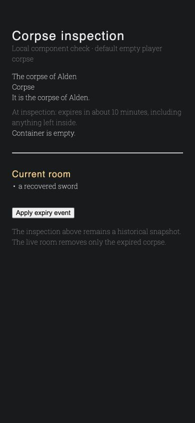

# World upkeep operations

From the repository root, preview one **runtime world ID** before enabling
cleanup in an environment:

```sh
docker compose exec backend python manage.py upkeep_preview 123 --limit 50
docker compose exec backend python manage.py upkeep_preview 123 --due --explain
docker compose exec backend python manage.py upkeep_preview 123 --after-id 456 --limit 50
```

The command only reads data. It reports deadlines, overdue age, policy,
protection reasons, retirement progress, and `tracked_root_rows`: the count
of indexed items sharing the physical root. This can include siblings of a
nested candidate and omit older unclassified descendants; it is not an exact
subtree size or an upper bound.
Use `next_after_id` for the next page; pages are capped at 100 rows. A null
deadline with `timer disabled` means intentional accumulation. Unclassified
objects remain untouched.

## Stop and resume upkeep

`WR_ITEM_UPKEEP_ENABLED=false` stops automatic and manual-advance item cleanup.
`WR_DOOR_UPKEEP_ENABLED=false` stops scheduled door resets. Set these in the
environment for **backend, celery-worker, and celery-beat**, then recreate
those services so all processes read the same settings:

```sh
docker compose up -d --force-recreate backend celery-worker celery-beat
```

Use the environment's normal release mechanism outside local development.
Both default to `true`. Initial door materialization still occurs when the
door switch is off. Disabling item upkeep preserves rows, deadlines and staged
retirement. Re-enable it to resume bounded processing; it does not grant a new
lifetime. Already retired objects remain unavailable meanwhile. Stopping a
world is a different operation and can delete transient items.

## Processing limits and diagnosis

The item dispatcher wakes every five seconds, selects at most 128 due running
runtimes, and gives each a 30-second poll interval. It orders by oldest poll
before runtime ID. Due discovery uses indexed `EXISTS`, excludes paused worlds
before limiting, and does not load retained inventories. Wake messages expire
after 30 seconds. Failed dispatches can retry on the next eligible poll.

Each runtime job claims its world row with `SKIP LOCKED`, considers at most 32
due roots/objects, and budgets 128 retirement/descendant/deletion row operations.
It stops admitting candidates after three seconds. The final bounded deletion
batch and commit can exceed that soft time target; there is no claim of a hard
wall-time deadline. An oversized bag retires immediately and drains over
subsequent jobs. Roots stay until their descendants are removed. Transfers
reject retiring ancestors, and recovered objects cancel their deadlines under
the same root locks.

Logs from `spawns.item_lifecycle` report retired/deleted rows, work, skipped
locks, duration, budget exhaustion, and the oldest selected overdue age.
Dispatcher failures and door failures log their runtime ID. Room notifications
are aggregated per room per batch and delivered through the existing durable
outbox after commit. Reconnect reads authoritative item visibility.

Ordinary transfers are limited to 4,096 items and 32 container levels in a
single operation. Death transfers use indexed bulk updates so oversized
inventories can still leave a corpse without loading every descendant into
Python. That death work scales with the inventory being transferred; subsequent
cleanup still drains in bounded batches. Population and door policies remain separate; `never_reload` does not
disable items. The door dispatcher separately selects up to 128 running runtimes every five
seconds, rotating by their own persisted poll time. Runtime wakes expire after
the existing spawn cadence (15 seconds by default). Each scheduled door job
handles at most 100 candidate zones, prioritizing missing/changed schedules,
then oldest due deadlines. Explicit initial/repopulation flows retain their
existing behavior and zone/schedule/doorway lock order. Door logs report due
zones, processed zones, reset doors, duration, and budget exhaustion.

## Item population coordination

Item population counting is destination-scoped. It uses one grouped count per
entry across its destinations, with the existing live-container index. Parent
candidates are capped by each destination's quota and claimed with `SKIP LOCKED`;
a carried chest is not a parent candidate. The stock-unit token is runtime roll
metadata, not a new authored field or database migration.

Incoming transfers and creation take a transaction advisory lock on the runtime
and concrete destination after their actor/item locks. Spawn reconciliation uses
nonblocking destination/parent claims. If any claim is busy, the entire plan
pass rolls back, including its spec bookkeeping and respawn timestamp, and is
retried by the existing scheduler. This also preserves deferred hot edits for
`respawn.mode: none`. Independent runtimes do not share these locks. Cleanup
removals can make stock temporarily short until the next eligible pass; they
cannot cause a duplicate by increasing stock.

## First activation

Apply the schema migrations before starting code that uses these fields.
There is no WR1 migration, runtime bridge, or provenance backfill. Existing WR2
objects with unknown origin are left unclassified and do not suddenly expire.
Use fresh runtimes for complete policy coverage, or separately design and
authorize a previewable initialization with a fresh grace period.

Policy edits apply to new episodes only; running instances snapshot policy at
creation. To inspect policy behavior, use the builder's
[World Upkeep guide](../guides/builders/world-upkeep.md). The original design and
acceptance checklist are in [the implementation plan](../architecture/world-upkeep-plan.md).

## Local validation measurements

October 14 follow-up: canonical `make test` passed all 2,857 backend tests,
including 19 stock-counting and concurrency regressions; the strict docs build
also passed. Healthy item reconciliation used 14 queries for both one
and 64 slots. With 10,000 owned copies and one item at the target, the grouped
stock count used `spawn_item_live_container_def`, read one matching item row,
and completed in approximately 0.032 ms in PostgreSQL's `EXPLAIN ANALYZE`.
This measures the count query, not spawning or end-to-end command latency.
Threaded regression checks cover both drop/spawn orderings, carried-parent
claims, independent runtime locks, and retrying a blocked live edit when
ordinary respawning is disabled.

October 13, 2026, local Docker/PostgreSQL 15. Final verification: canonical
`make test` passed all 2,838 backend tests; all 307 frontend tests passed;
frontend and strict documentation production builds passed; migration drift
check reported no changes. Due discovery and world-scoped candidate queries
both selected the intended partial indexes.

- One due item alongside 10,000 retained items: 33 queries and approximately
  25 ms for retirement/deletion. `EXPLAIN ANALYZE` selected `item_upkeep_due`,
  inspected one matching row, and hit two shared buffers (about 0.009 ms for
  the candidate query). Retained population does not become a cleanup scan.
- 128 loot operations through 16 database connections: approximately 2.64 s
  total, 291 ms median, and 497 ms p95 in the isolated focused run. This
  measures the transactional acquisition path with response serialization
  disabled. It does not measure WebSocket delivery or whole-game capacity.
- The same workloads with the frontend suite running concurrently took
  157 ms and 11 s respectively; these timings are observations, not SLAs.
- Bounded retirement, lock contention, duplicate jobs, stop guards, queue
  fairness, first-empty timers, nested storage, and pause/advance rollback are
  covered by backend tests. Existing multi-corpse loot query/write limits pass.
- Player deaths with a 5,000-item bag and NPC deaths with 5,000 generated loot
  items both complete, preserve containment, and apply the proper corpse policy.

Responsive component checks used the real `ItemInfo.vue` and expiration state
helper in a temporary local harness, at desktop size and 390 px width, with no
horizontal overflow. The fixture was removed after inspection. These are UI
component checks; backend event/clock behavior is covered separately.



